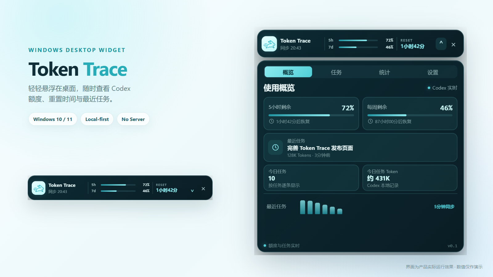
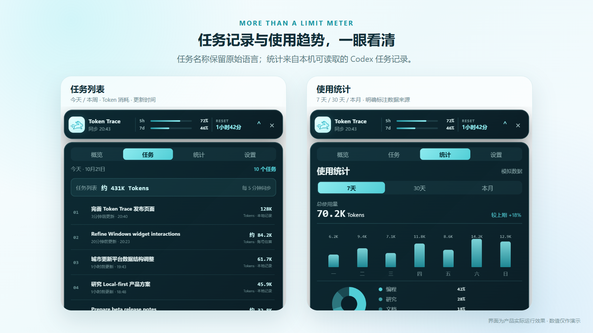
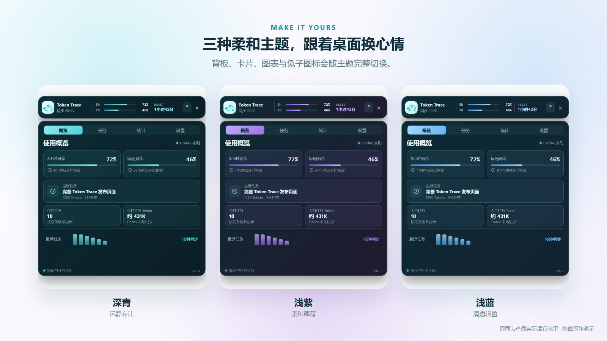

# Token Trace

> A local-first Windows desktop widget for viewing Codex usage limits and recent task token activity.



[](https://github.com/lolikaaaaa/token-trace/releases/latest)


[⬇️ 下载最新版](https://github.com/lolikaaaaa/token-trace/releases/latest) · [🐛 报告问题](https://github.com/lolikaaaaa/token-trace/issues) · [⭐ 喜欢的话点个 Star](https://github.com/lolikaaaaa/token-trace)

第一个小工具试试水，不要骂嘤嘤。不知道有没有什么 bug。会持续更新！！

> Token Trace 是一个轻量的 Windows 桌面悬浮组件。它在本机连接 Codex App Server，显示当前账户的 5 小时/每周剩余额度、重置时间，以及当天最近任务和相应 Token 记录。

> 🐰 嗨！这是我第一次从零做 Windows 小工具。很多地方都是一边学习、一边和 Codex 打磨出来的。它可能还不完美，但这只小兔子已经可以认真替你看着用量啦。遇到问题欢迎提 Issue，也请温柔地告诉我，嘻嘻。

## 一眼看懂

- **看额度**：显示真实 5h / 7d 剩余比例与 Reset 倒计时。
- **看任务**：按今天 / 本周查看最近任务、Token 消耗和更新时间。
- **看趋势**：按 7 天 / 30 天 / 本月汇总本机可读取的任务记录。
- **换主题**：深青、浅紫、浅蓝三种完整主题，适配不同桌面。





## 功能

- 无边框、透明背景、始终置顶的桌面小组件
- Mini Widget 与原地展开面板
- 真实 5h / 7d 剩余比例和 Reset 倒计时
- 今天 / 本周任务切换，最多显示 10 条并支持内部滚动
- 每个任务对应的 Token 总量和更新时间
- 青色、浅紫、浅蓝三种主题
- 三套主题会同步改变玻璃背板、卡片、图表和兔子图标色彩
- 7天、30天、本月任务 Token 统计，明确标记数据来源
- 启动时同步，之后每 5 分钟更新；休眠恢复后自动补刷
- Local-first：不使用 Token Trace 自建服务器

## 数据说明

- 额度数据来自当前 Windows 用户登录的 Codex App Server。
- 任务 Token 优先使用 Codex 提供的任务估算；不可用时读取本机 Codex 会话中记录的 Token 总量。
- “本地记录”表示上下文 Token 统计，不代表 API 账单金额。
- 无可用记录时显示“暂不可用”，不会用模拟数字替代。

## 系统要求

- Windows 10/11 x64
- 已安装并登录 Codex Windows 应用
- Microsoft Edge WebView2 Runtime（Windows 11 通常已经包含）

## 下载与试用

请从仓库的 **Releases** 页面下载最新安装包：

1. 下载 `Token-Trace-v0.1.0-beta.6-Setup.exe`。
2. 双击安装；如果 Windows SmartScreen 提示未知发布者，请确认文件来自本仓库后再决定是否继续。
3. 点击箭头展开或收起，拖动顶部区域可移动组件。
4. 不再使用时可以从 Windows“已安装的应用”中卸载。

测试版尚未进行代码签名，Windows SmartScreen 可能显示“未知发布者”。请仅从本仓库 Releases 下载。

## 本地开发

需要 Node.js、Rust、Tauri 2 的 Windows 构建依赖和 WebView2。

```bash
npm install
npm run tauri dev
```

构建 Windows 应用：

```bash
npm run tauri build
```

## 隐私与安全

Token Trace 不会读取或上传 `auth.json` 的内容，不会把 API Key、访问令牌或刷新令牌传给前端，也不会把 Usage 或任务数据发送给开发者服务器。详见 [PRIVACY.md](PRIVACY.md) 和 [SECURITY.md](SECURITY.md)。

## 当前限制

- Windows 是当前稳定测试平台；macOS 预览版正在适配，尚未在真实 Mac 上完成验收或 Apple 签名、公证。
- 统计页基于本机可读取的任务记录，不是 OpenAI 官方账单；缺失或已删除的历史任务无法补齐。
- 当前尚未建立独立的长期 SQLite 历史数据库。
- Codex App Server 协议变化可能影响兼容性。
- 便携测试版没有自动更新功能。

## 技术栈

- Tauri 2
- React 19
- TypeScript
- Rust

## macOS 预览版

项目已加入 macOS 跨平台路径发现、透明悬浮窗口配置和 Universal（Apple Silicon + Intel）自动构建。可以在 GitHub Actions 中手动运行 **Build macOS preview**，下载未签名的 `.app` / `.dmg` 测试包。

未签名测试包可能被 Gatekeeper 拦截，仅建议从本仓库 Actions 下载并在测试设备上使用。正式公开发行前仍需：

- 在真实 Mac 上验证 Codex App Server、额度和任务数据读取；
- 验证窗口置顶、拖动、休眠恢复及多显示器行为；
- 使用 Apple Developer ID 完成签名和 Notarization。

## 贡献

欢迎提交 Issue 和 Pull Request。请先阅读 [CONTRIBUTING.md](CONTRIBUTING.md)。

## 声明

Token Trace 是社区独立项目，与 OpenAI 无隶属或背书关系。Codex、OpenAI 及相关商标归其各自权利人所有。
